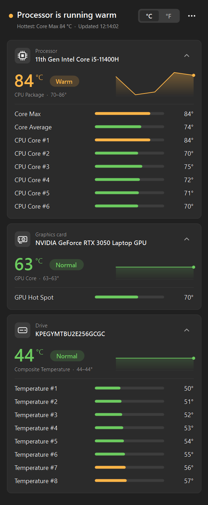

# Temp Monitor: CPU, GPU and SSD temperature monitor for Windows

[](https://github.com/Shockwave3301/windows_temp_monitor/releases/latest)
[](https://github.com/Shockwave3301/windows_temp_monitor/releases)
[](#requirements)
[](LICENSE)

**Temp Monitor** is a free, open-source app that shows live **CPU, GPU, SSD and hard drive, motherboard and RAM temperatures** on Windows 11 and Windows 10. It's portable: one 1.8 MB exe with no installer, no ads and no telemetry. A one-line summary tells you straight away whether your PC is running normal, warm or hot.

**[Download TempMonitor.exe](https://github.com/Shockwave3301/windows_temp_monitor/releases/latest/download/TempMonitor.exe)** (latest release, 64-bit)

<p align="center"></p>

## Features

- **Answers "is my PC OK?" at a glance.** A one-line summary at the top says whether everything is normal or which device is running warm or hot.
- **Every temperature sensor in one window:** CPU package and per-core temperatures, GPU core and hot spot, NVMe and SATA drives, motherboard, and DDR5 memory where supported. Works with most Intel and AMD processors and NVIDIA and AMD graphics cards, in laptops and desktops.
- **One card per device**, with a large colour-coded temperature, a Normal / Warm / Hot label, and a 2-minute trend line. Per-core and other readings are shown as bars; click a card's header to collapse them.
- **Sensible limits per device type**, so a CPU at 80 °C and a drive at 80 °C aren't treated the same (see [What "Warm" and "Hot" mean](#what-warm-and-hot-mean)).
- **Light and dark mode** follow your Windows setting, including High Contrast.
- **One file, ~1.8 MB.** No installer and no runtime to download. It uses .NET Framework 4.8, which is already part of Windows 10 (1903+) and Windows 11.
- **°C or °F**, always on top, reset min/max, and copy readings to the clipboard. Settings and window position are remembered.

## Download

Download [`TempMonitor.exe`](https://github.com/Shockwave3301/windows_temp_monitor/releases/latest/download/TempMonitor.exe) from the [latest release](https://github.com/Shockwave3301/windows_temp_monitor/releases/latest) and run it. There's nothing to install; you can keep the file anywhere.

Each release also lists the file's SHA-256 checksum in `SHA256SUMS.txt`.

### First run

1. **Windows asks for administrator permission.** Click **Yes**. Reading CPU and motherboard sensors requires low-level hardware access, so every hardware monitor (HWiNFO, HWMonitor, LibreHardwareMonitor) needs admin rights.
2. **SmartScreen may warn about an unrecognized app** because the exe isn't code-signed. Click **More info → Run anyway**.
3. **CPU temperatures need the PawnIO driver.** If it isn't installed, a yellow bar offers to install it. Temp Monitor downloads the official PawnIO installer, checks it against a known checksum, and runs it. GPU and drive temperatures work without it.

## What "Warm" and "Hot" mean

Each card's label follows its headline reading (CPU package, GPU core, drive composite temperature, and so on):

| Device | Warm from | Hot from |
|---|---|---|
| Processor | 80 °C | 90 °C |
| Graphics card | 75 °C | 85 °C |
| Drive | 55 °C | 70 °C |
| Memory | 60 °C | 75 °C |
| Motherboard and other | 60 °C | 80 °C |

GPU "hot spot" and memory "junction" sensors normally run about 10 °C above the core reading, so their limits are 10 °C higher. These are general guides, not manufacturer limits: a laptop CPU at 85 °C under a game is usually fine, while the same temperature at idle is worth a look.

## About PawnIO

[PawnIO](https://pawnio.eu) is a signed, open-source driver that lets programs read CPU and motherboard sensors safely. It replaces the old WinRing0 driver, which Windows Defender now flags as vulnerable. LibreHardwareMonitor and other monitoring tools use it too. You can uninstall it any time from **Settings → Apps**.

## Requirements

- Windows 10 version 1903 or newer, or Windows 11
- 64-bit (x64) PC
- Administrator rights

## FAQ

### How do I check my CPU temperature on Windows 11 or 10?

Windows doesn't show CPU temperature anywhere built in; Task Manager only shows the temperature of a dedicated graphics card. Download [`TempMonitor.exe`](https://github.com/Shockwave3301/windows_temp_monitor/releases/latest/download/TempMonitor.exe), run it, click **Yes** when Windows asks for administrator permission, and install PawnIO when the yellow bar offers it. The big number on the Processor card is your CPU temperature: "CPU Package" on Intel, "Core (Tctl/Tdie)" on AMD Ryzen.

### What is a normal CPU temperature?

At idle, most desktop CPUs sit around 30–50 °C and laptop CPUs around 40–60 °C. Under a heavy load such as gaming, 70–85 °C is common. Readings that stay near 95–100 °C mean the CPU has reached its limit and is probably slowing itself down to cool off (thermal throttling). Temp Monitor marks a processor Warm from 80 °C and Hot from 90 °C; the limits for graphics cards, drives and memory are in [What "Warm" and "Hot" mean](#what-warm-and-hot-mean).

### What is a normal GPU or SSD temperature?

Graphics cards usually run around 30–50 °C at idle and 65–85 °C while gaming; the "hot spot" sensor reads about 10 °C higher than the core. NVMe and SATA SSDs are normally 30–50 °C, and many slow down to protect themselves at around 70–80 °C.

### Why does it need administrator rights? Is it safe?

Reading CPU and motherboard sensors means talking to the hardware directly, which Windows only allows for administrators, so HWiNFO, HWMonitor and LibreHardwareMonitor need admin rights too. Temp Monitor is open source and every release is built by [GitHub Actions](.github/workflows/build.yml) from this repository, with a SHA-256 checksum. It doesn't connect to the internet, except to download the PawnIO installer if you ask it to, and has no ads or telemetry.

### Why are my CPU temperatures missing?

CPU and motherboard temperatures need the [PawnIO](#about-pawnio) driver; if it isn't installed, a yellow bar at the top of the window offers to install it. Virtual machines don't expose temperature sensors, and very new or unusual hardware may not be recognised yet. If something is missing, run `TempMonitor.exe --dump temps.txt` (see [Command line](#command-line)) and attach the file to an [issue](https://github.com/Shockwave3301/windows_temp_monitor/issues).

### How is it different from HWiNFO, HWMonitor or Core Temp?

HWiNFO and HWMonitor show every sensor in your PC, including voltages, fan speeds, clock speeds and power draw, which is great for troubleshooting but a lot to read. Core Temp focuses on the processor. Temp Monitor shows only temperatures, for the CPU, graphics card, drives, motherboard and memory, and tells you in plain words whether any of them is running warm or hot.

## Command line

Write a one-off snapshot of all sensors to a text file, which is useful when reporting a problem:

```bash
TempMonitor.exe --dump temps.txt
```

Other options:

| Option | Effect |
|---|---|
| `--theme dark` / `--theme light` | Ignore the Windows light/dark setting |
| `--snapshot file.png` | Render the whole window to an image after a few seconds, then exit (used for the screenshot above) |

## Building from source

Requires the [.NET SDK](https://dotnet.microsoft.com/download) 8 or newer. It builds a .NET Framework 4.8 exe, so the .NET runtime is not needed to run it.

```bash
dotnet build -c Release
```

Output: `bin/Release/net48/TempMonitor.exe`

### Releases

Pushing a tag such as `v1.2.0` runs the GitHub Actions workflow in `.github/workflows/build.yml`. It builds the exe with that version number and publishes a GitHub Release with the exe and its checksum.

```bash
git tag v1.0.0
```

```bash
git push origin v1.0.0
```

## Project layout

| File | Purpose |
|---|---|
| `MainForm.cs` | Window, sensor polling, summary line, menu, PawnIO install flow |
| `HeaderView.cs` | Top bar: summary, °C/°F switch, menu button |
| `DashboardView.cs` | Scrollable, custom-drawn device cards |
| `Cards.cs` | Groups readings into cards; thresholds, trend history, min/max |
| `Theme.cs` | Light, dark and High Contrast colours; dark title bar and scrollbars |
| `Ui.cs` | Fonts, drawing helpers, device icons, themed menu |
| `Sensors.cs` | Reads temperature sensors through LibreHardwareMonitorLib |
| `PawnIo.cs` | Detects PawnIO and downloads/verifies/runs its installer |
| `Settings.cs` | Saves preferences in `HKCU\Software\TempMonitor` |
| `Program.cs` | Entry point, error handling, `--dump` |
| `app.manifest` | Admin rights, DPI awareness, Windows 10/11 compatibility |

## License

MIT. See [LICENSE](LICENSE). Sensor access is provided by [LibreHardwareMonitorLib](https://github.com/LibreHardwareMonitor/LibreHardwareMonitor) (MPL-2.0); see [THIRD-PARTY-NOTICES.md](THIRD-PARTY-NOTICES.md) for all bundled components.
